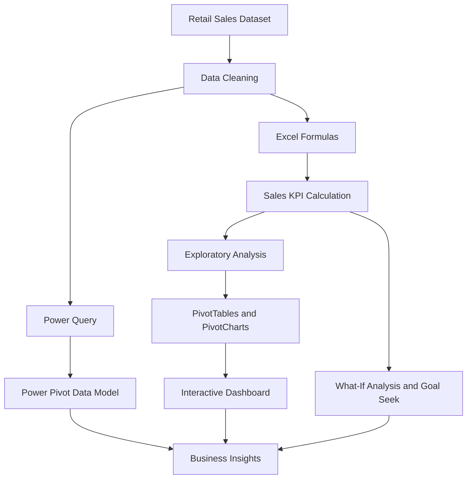

# 📊 Excel Super Store Sales Data Analysis

<p align="center">
  
  
  
  
  
</p>

<p align="center">
  <b>Transforming retail sales data into meaningful business insights using Advanced Microsoft Excel.</b>
</p>

---

## 📌 Project Overview

The **Super Store Sales Data Analysis** project focuses on analyzing retail sales transactions to understand sales performance, product trends, customer segments, discount strategies, and time-based revenue patterns.

Using Microsoft Excel's advanced analytical capabilities, the project follows a structured data analysis workflow, from data preparation and formula-based calculations to PivotTables, visualizations, interactive dashboards, and business recommendations.

The project also explores automation and analytical modeling using Macros, Power Query, Power Pivot, What-If Analysis, and Goal Seek.

## 🎯 Project Objectives

- Clean and organize raw retail sales transaction data.
- Calculate sales metrics using advanced Excel formulas.
- Analyze sales performance across products, categories, customers, and shipping modes.
- Identify trends across daily, monthly, and quarterly periods.
- Evaluate the impact of discounts on adjusted sales and profitability.
- Build PivotTables and PivotCharts for interactive analysis.
- Develop a dashboard with key performance indicators (KPIs).
- Use What-If Analysis and Goal Seek to evaluate business scenarios.
- Explore task automation with Macros.
- Apply Power Pivot and data modeling to connect related tables.
- Provide actionable recommendations for improving sales performance.

## 🗂️ Dataset Overview

The project uses retail sales transaction data containing order information, product details, customer attributes, shipping information, sales, discounts, and profit.

### Key Data Fields

| Column | Description |
|---|---|
| Order ID | Identifier for a customer order |
| Order Date | Date the order was placed |
| Ship Date | Date the order was shipped |
| Product ID | Identifier for a product |
| Product Name | Name of the product |
| Category | Product category |
| Sub-Category | Product subcategory |
| Customer ID | Identifier for a customer |
| Customer Name | Customer's name |
| Segment | Customer segment |
| Country | Country associated with the transaction |
| City | City associated with the transaction |
| State | State associated with the transaction |
| Region | Sales region |
| Ship Mode | Shipping method |
| Sales | Sales amount |
| Quantity | Number of units sold |
| Discount | Discount applied |
| Profit | Profit associated with the transaction |

*Note: The exact column names and availability should be checked against the workbook included in the repository.*

## 🧹 Data Cleaning and Preparation

The data preparation workflow covers:

- Checking for duplicate records and blank entries.
- Reviewing missing values and inconsistent data.
- Formatting order and shipping dates correctly.
- Applying consistent number and currency formats.
- Validating sales and discount values.
- Flagging suspicious or erroneous sales records with `IF` and `IFERROR`.
- Reviewing outliers and unexpected values.
- Preparing structured tables for analysis.

### Example: Adjusted Sales

A discount-adjusted sales metric can be calculated as:

\[
\text{Adjusted Sales}=\text{Sales}\times(1-\text{Discount})
\]

Example Excel formula:

```excel
=[@Sales]*(1-[@Discount])
```

This assumes that `Discount` is stored as a decimal or percentage, such as `0.10` or `10%`. Validate negative values and the source data's discount convention before calculating the metric.

## 🧮 Excel Formulas and Analytical Techniques

The project description includes several Excel functions for analyzing sales transactions.

| Function | Application |
|---|---|
| `SUM` | Calculate total sales and discounts |
| `AVERAGE` | Calculate average sales |
| `IF` | Apply conditional logic and flag invalid records |
| `IFERROR` | Handle formula errors |
| `COUNTIF` | Count records matching a condition |
| `COUNTIFS` | Count records matching multiple conditions |
| `AVERAGEIF` | Calculate average discount by customer segment |
| `MONTH` | Extract the month from a date |
| `YEAR` | Extract the year from a date |
| `WEEKDAY` | Analyze sales by day of the week |
| `EOMONTH` | Group transactions by month-end periods |

### Key Business Metrics

- Total sales
- Adjusted sales
- Average sales per order
- Total discounts
- Quantity sold
- Profit
- Profit margin
- Sales by product category
- Sales by customer segment
- Sales by shipping mode

## 📈 Exploratory Sales Analysis

The analysis is designed to investigate several business questions.

### 1. Product and Category Performance
- Which product categories generate the highest sales?
- Which subcategories contribute the most to revenue?
- Which products sell the highest quantities?
- Which products or categories show weaker performance?

### 2. Customer Segment Analysis
- How do sales vary across customer segments?
- Which segments generate the highest sales?
- How does the average discount differ between segments?

### 3. Shipping Mode Analysis
- Which shipping modes are associated with the highest sales?
- How do average sales and total discounts vary by shipping mode?
- Are there differences in sales performance across shipping methods?

### 4. Time-Based Analysis
- Which months and quarters have the highest sales?
- Are there recurring seasonal sales patterns?
- How does sales performance change over time?

### 5. Discount and Profitability Analysis
- How do discounts affect adjusted sales?
- Which categories combine strong sales with healthy profits?
- Are higher discounts associated with lower profitability?

*These are the project's analytical questions, not claimed findings. Actual conclusions should be based on the workbook's calculated results.*

## 📊 PivotTables and PivotCharts

PivotTables organize transaction data into summaries that support faster business analysis.

Planned analytical views include:

- Sales by product category and subcategory.
- Sales by customer segment.
- Sales by shipping mode.
- Monthly and quarterly sales trends.
- Quantity sold by product.
- Total discounts and profit by category.

PivotCharts can display these summaries through bar charts, column charts, and line charts.

Slicers and date filters can make the analysis interactive by allowing users to filter categories, customer segments, shipping modes, and reporting periods.

## 📉 Interactive Sales Dashboard

The dashboard is designed to present important sales KPIs and visual summaries in one place.

### Proposed KPI Cards

| KPI | Purpose |
|---|---|
| Total Sales | Measures overall sales performance |
| Adjusted Sales | Shows sales after the defined discount adjustment |
| Average Order Value | Measures average sales value per order |
| Total Discounts | Tracks the value of discounts applied |
| Total Quantity | Measures product volume sold |
| Total Profit | Tracks profitability |
| Profit Margin | Measures profit relative to sales |

### Suggested Dashboard Visuals

- Sales trend by month.
- Sales by product category.
- Sales by customer segment.
- Sales by shipping mode.
- Top-performing products.
- Discount versus profit comparison.

### Interactive Features

- PivotTable slicers.
- Date-based filtering.
- Category and segment selection.
- Dynamic PivotCharts.
- KPI summaries that respond to available filters.

## 🔍 What-If Analysis and Goal Seek

The project description includes scenario-based analysis to understand how changing business assumptions can affect sales performance.

Example scenarios:

- What happens to revenue if sales increase by 10%?
- How does adjusted sales change if discount rates decrease by 5 percentage points?
- How many units must be sold to reach a defined sales target?
- How does changing sales or discount assumptions affect profit?

**Goal Seek** can identify the input required to reach a specified output, while **Scenario Manager** can compare alternative business assumptions.

## ⚙️ Automation with Macros

Excel Macros can automate repetitive activities such as:

- Formatting worksheets.
- Applying currency and date formats.
- Preparing summary tables.
- Refreshing and formatting reports.
- Generating recurring charts.
- Standardizing report layouts.

Automating these tasks can reduce repetitive manual work and improve reporting consistency.

## 🧩 Power Query and Power Pivot

### Power Query
Power Query supports repeatable data preparation tasks, including importing data, changing data types, cleaning records, and transforming columns before analysis.

### Power Pivot
Power Pivot supports data modeling by connecting related tables.

The proposed model includes:

**Products table**
- Product ID
- Product Name
- Category
- Sub-Category
- Sales
- Quantity
- Discount
- Profit

**Customers table**
- Customer ID
- Customer Name
- Segment
- Country
- City
- State
- Postal Code
- Region

These tables can be connected to the sales transactions table through matching product and customer identifiers, where the source data supports those relationships.

### Example: Profit Margin

A Power Pivot calculated column or measure can express profit margin as:

```DAX
Profit Margin =
DIVIDE(SUM(Products[Profit]), SUM(Products[Sales]), 0)
```

The expression above is a measure example and assumes that the `Products` table contains the relevant sales and profit values. Adapt table names and relationships to the actual workbook model.

## 🔄 Project Workflow



## 💡 Business Insights and Recommendations

The analysis is intended to support recommendations in the following areas:

- **Product strategy:** Prioritize products and categories with strong sales and profitability.
- **Discount strategy:** Evaluate whether discounts support higher sales without excessively reducing profit.
- **Customer strategy:** Identify valuable customer segments and differences in purchasing behavior.
- **Shipping strategy:** Compare shipping modes using sales, discounts, and other available performance measures.
- **Seasonality:** Use monthly and quarterly trends to support inventory and promotional planning.
- **Reporting efficiency:** Use refreshable data transformations, PivotTables, and automation to streamline reporting.

Recommendations should be finalized after reviewing the actual results in the Excel workbook.

## 🛠️ Tools and Technologies

| Tool | Purpose |
|---|---|
| Microsoft Excel | Data analysis and reporting |
| Excel Formulas | Calculations and conditional logic |
| PivotTables | Aggregation and summarization |
| PivotCharts | Data visualization |
| Slicers | Interactive filtering |
| What-If Analysis | Scenario evaluation |
| Goal Seek | Target-based calculations |
| Macros / VBA | Repetitive task automation |
| Power Query | Data transformation |
| Power Pivot | Data modeling and advanced analysis |
| DAX | Measures and analytical calculations |

## 🚀 How to Use the Project

1. Open the Excel workbook available in this repository.
2. Review the original sales transaction data.
3. Inspect the cleaning and formula-based calculations.
4. Explore PivotTables and PivotCharts.
5. Open the dashboard and interact with available filters.
6. Review What-If Analysis and Goal Seek scenarios, if implemented.
7. Inspect the Power Query transformations, data model, or Macros, where available.
8. Use the resulting analysis to investigate business performance.

*The exact workbook filenames, worksheet names, and implemented features should be verified against the repository before publishing this README.*

## 🔮 Future Enhancements

- Add sales forecasting using historical trends.
- Create a dedicated profitability analysis dashboard.
- Add product-level and customer-level drill-down reports.
- Improve automated data refresh and reporting.
- Compare sales and profit across different discount scenarios.
- Develop a more comprehensive data model for reusable reporting.
- Integrate the analysis with Power BI for additional visualization capabilities.

## 👨‍💻 Author

**Parthasarathi A**

Data Analytics | Advanced Excel | SQL | Power BI | Python

- **GitHub:** [ParthasarathiAnalytics](https://github.com/ParthasarathiAnalytics)
- **Portfolio:** [View My Portfolio](https://parthasarathi-analytics.vercel.app/)

---

<p align="center">
  <b>Turning retail sales data into business insights through advanced Excel analytics.</b>
</p>
